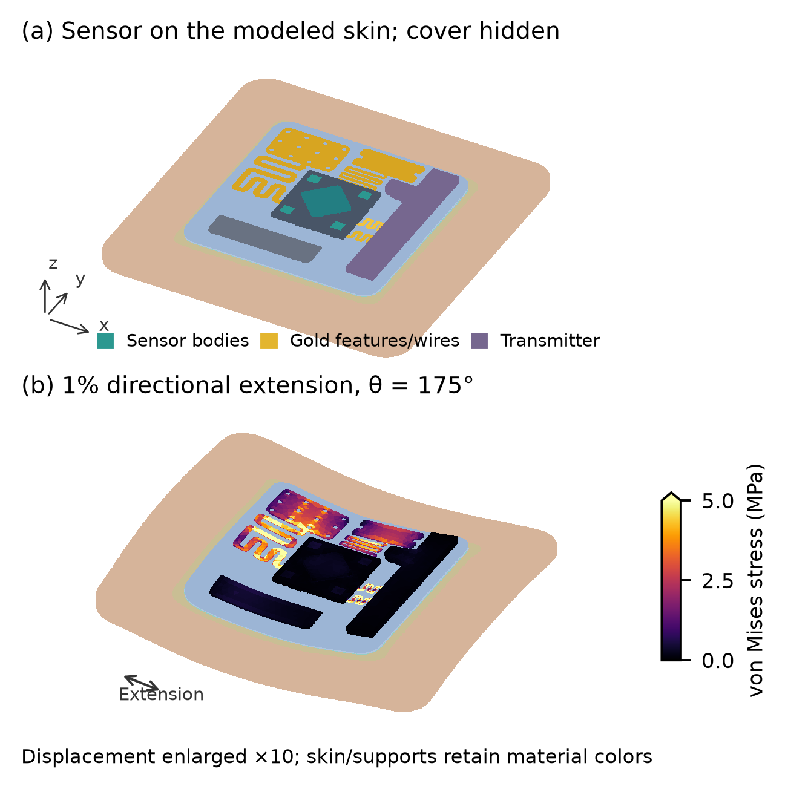

# Evaluation of Multilayer Designs for Stable Wearable Biosensors

Completed three-dimensional mechanical study of the supplied sixteen-body wearable biosensor CAD. Gmsh 4.15.2 meshes the assembly; CalculiX 2.17 (Ubuntu package 2.17-3), using SPOOLES under WSL Ubuntu 22.04, solves it. Python reconstructs tensor fields, checks the results, and builds the figures and manuscript. ANSYS was not used for these results.

## Manuscript and data

- [Seven-page proceeding, PDF](advanced/output/Biosensor_Advanced_Proceeding.pdf)
- [Editable Word manuscript](advanced/output/Biosensor_Advanced_Proceeding.docx)
- [Main response table, CSV](advanced/output/All_Directional_Responses.csv)
- [Final numerical and refinement summary](advanced/output/Final_Study_Summary.json)
- [Research archive index and checksums](advanced/output/Research_Package_Index.json)
- [Detailed methods and reproduction commands](advanced/README.md)

The title and abstract share page 1. All seven exported pages were rendered and visually inspected. The manuscript contains four figures, three tables, ten references, and the supplied author/affiliation information.

## What was simulated

The main filled-contact grid compares three support architectures, three adhesive moduli, and three effective skin moduli: 27 material configurations. Three independent linear basis solutions per configuration reconstruct 36 sampled extension directions, giving 972 directional responses. Equal biaxial extension and shear add 54 responses. These reconstructed states are not 1,026 independent solver runs.

Three nominal supplied-contact configurations preserve the original CAD attachment as a separate sensitivity comparison. Seven selected configurations have finer-mesh comparisons, including all nominal architectures and the main grid's worst wire, skin, and adhesive cases.

The accepted study contains **148 distinct assembly load cases**, **8 auxiliary numerical correction solves**, and **12 matched bare-skin reference solves**. Independent high-contrast comparisons, analytical cubes, free-DOF equilibrium, constrained-reaction energy checks, and a direct mixed-load comparison for every configuration support numerical acceptance. See [the numerical review](advanced/NUMERICAL_REVIEW.md) and [the final summary](advanced/output/Final_Study_Summary.json).

## Findings and interpretation

At nominal materials, the wire strain percentile varies about 2.6-fold with extension direction. Both compliant architectures have higher sampled maximum wire strain than uniform support in this assembly. The small graded-versus-single difference is below their observed refinement changes and is not treated as resolved design superiority.

The main comparison retains wire strain, disturbance relative to matched bare skin, and adhesive distortion as separate objectives. Six options are sampled nondominated under these explicit metrics and sensitivity levels. The original CAD has a 10 micrometre broad-plane skin/adhesive gap; the specified gap-filled alternative is kept distinct and is not asserted to represent manufactured contact.

These are conditional linear-elastic screening results. Unidentified package and material properties are explicit surrogates, bonding is idealized, and physical calibration is absent. Hidden chip internals, electrical response, fatigue, comfort, and clinical outcomes are outside the simulated scope. Numerical agreement is not a claim of ANSYS-equivalent physical accuracy.

## Reproduce and inspect

Follow [advanced/README.md](advanced/README.md). The retained environment records identify the actual solver binary and pinned Python packages. Large solves run sequentially. Fine meshes exceeded the default WSL RAM/swap allocation during an early attempt; the resource recovery and subsequent cleanup are recorded. Provide adequate RAM/swap for fresh fine-mesh runs. Native Word export in this workflow requires Microsoft Word on Windows.

Git retains the original STEP file, source code, scalar data, verification evidence, figures, and the new manuscript. Large solver decks, arrays, and archives are excluded from Git. The local research archives contain all accepted-case inputs and records plus explicitly selected field arrays; [the index](advanced/output/Research_Package_Index.json) documents the selection and omissions. Per-file SHA256 manifests are verified by reading every archived file back.

## Earlier work

The earlier [detailed study](detailed/README.md) and [two-dimensional study](README_2D.md) are preserved for traceability. The earlier nineteen-case manuscript is provisional: later free-DOF and direct-field checks identified numerical problems. Its old rankings must not be substituted for the verified `advanced/` study above.

Joel Whaling, Aarav Patel, Mandy Hung, Yuancheng Fang, Leona Cai, Zenan Li, Advik Raja, Nathan Xu, and Linda Shi. Institute of Engineering in Medicine, University of California San Diego, USA; the manuscript marks IEM OPALS high school participants as supplied. Corresponding email can be added when provided. The manuscript has not been submitted through this project.
