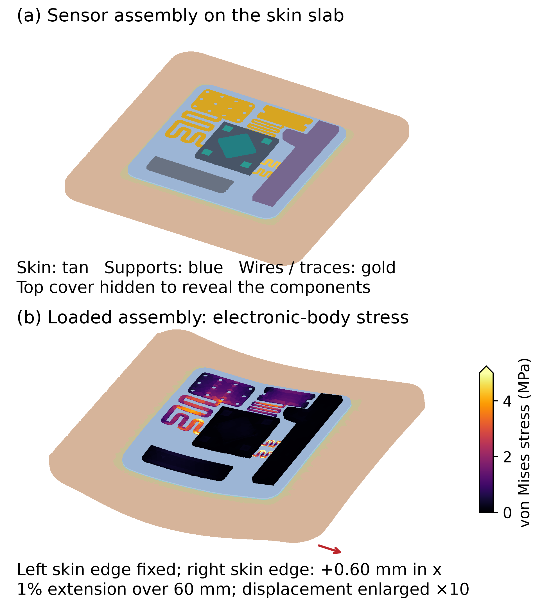

# Evaluation of Multilayer Designs for Stable Wearable Biosensors

Three-dimensional finite-element evaluation of a sixteen-body wearable biosensor assembly under prescribed skin motion. Gmsh generates quadratic tetrahedral meshes; CalculiX CrunchiX performs the structural solves; Python prepares inputs, checks numerical consistency, and produces component metrics, figures, and the manuscript.

**Validation review in progress:** the [advanced extension](advanced/README.md) adds local free-DOF equilibrium and direct tensor-superposition checks. Its read-only audit identified earlier assembly cases that require verified reruns. Treat the earlier manuscript and design rankings below as provisional while that review is completed. The old files are preserved for traceability and are not silently replaced.

## Read and view

- [Eight-page manuscript (PDF)](detailed/output/Biosensor_Proceeding_3D.pdf)
- [Editable manuscript (Word)](detailed/output/Biosensor_Proceeding_3D_Layout_Checked.docx)
- [Detailed methods, material assumptions, and reproduction instructions](detailed/README.md)
- [Component results for all 19 converged linear cases](detailed/output/All_Component_Results.csv)
- [Numerical audit](detailed/output/Study_Audit.json)
- [Sensor on skin and simulated stress diagram](detailed/output/figures/Sensor_On_Skin_3D.png)

Download `detailed/output/Biosensor_3D_Viewer.html` and open it locally for an interactive view of the CAD bodies. The Word file uses a continuous section break below the title; some browser previews paginate it differently. The PDF preserves the checked eight-page layout.



## Scope and principal finding

The model includes the supplied skin, adhesive, support and cover, ABS bodies, five sensor components, transmitter, patterned gold features, and two routed gold wires. The largest mesh has 374,893 quadratic tetrahedra and 1,750,458 displacement degrees of freedom. Nineteen linear assembly cases examine three support designs, mesh refinement, skin loading, and assumed material stiffness.

For the specified 1% skin extension, finest-mesh combined wire mean von Mises stresses are 3.344 MPa (uniform PDMS), 4.155 MPa (single compliant buffer), and 4.084 MPa (graded buffer). The buffered designs increase this wire metric in this assembly. Component-specific tradeoffs matter; the small single-to-graded difference is below the measured last-refinement change.

These are conditional linear-elastic screening results. Unidentified component properties are explicit surrogates, all interfaces are perfectly bonded, and physical calibration is absent. Exploratory full-assembly nonlinear attempts did not converge and are excluded from reported stress results. No electrical performance, fatigue life, clinical safety, or ANSYS-equivalent accuracy is claimed. ANSYS was not used for the reported simulations.

## Reproduce

Use Python 3.12 and install `detailed/requirements_3d.txt`. Install CalculiX 2.23 separately as described in [the detailed instructions](detailed/README.md#reproduce). The full sequence there rebuilds the mesh, benchmarks, 19 cases, visualizations, and Word manuscript. Solver runs require substantial memory and should run sequentially. PDF export and Word normalization require Microsoft Word on Windows.

```powershell
python -m pip install -r detailed/requirements_3d.txt
# Follow detailed/README.md to install CalculiX and run the full study.
# With the archived mesh and field files restored:
python detailed/build_detailed_paper.py
./detailed/normalize_word_layout.ps1
```

The Git repository contains source code, original STEP geometry, retained manuscript template, scalar results, execution records, figures, and manuscripts. Large generated meshes, field arrays, solver decks, and solver binaries are excluded from Git. The `research-v1` release asset `Biosensor_3D_Research_Package.zip` includes accepted meshes, selected finest-mesh fields and decks, and execution records. Extract it into the repository root, preserving `detailed/`, to restore those inputs. The separately installed solver is not bundled.

## Earlier two-dimensional work

The root-level simulation scripts and `results/` retain the earlier simplified 2D study. [README_2D.md](README_2D.md) documents its different geometry and assumptions. Its stress reductions must not be interpreted as results for the detailed 3D assembly. The current manuscript and figures are under `detailed/output/`; earlier artifacts are under `output/`.

## Authors and review status

Joel Whaling, Aarav Patel, Mandy Hung, Yuancheng Fang, Leona Cai, Zenan Li, Advik Raja, Nathan Xu, and Linda Shi. Affiliation: Institute of Engineering in Medicine, University of California San Diego, USA. The manuscript identifies the participating IEM OPALS high school students.

The corresponding author, email, and final venue requirements remain for author confirmation. Authors should independently review the assumptions, implementation, results, and manuscript. AI assistance was used in implementing the workflow and drafting the document. The manuscript has not been submitted through this project.
